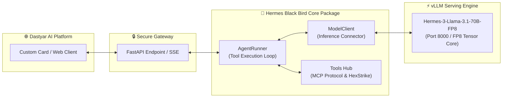

<div dir="rtl">

# 🦅 Hermes Black Bird

<p align="center">
  
</p>

<p align="center">
  
  
  
  
  
  
</p>

> **زیرساخت و بسته نرم‌افزاری مستقل (Portable Package) برای کاستومایز کردن مدل‌های زبانی بزرگ و اتصال به ابزارهای پیچیده (MCP)**

---

## 📖 درباره پروژه (Project Overview)

پروژه **Hermes Black Bird** یک محیط آزمایشگاهی و زیرساخت ایزوله است که با هدف **کپسوله‌سازی (Encapsulation)** مدل زبانی قدرتمند **Hermes-3 (Llama-3.1-70B-FP8)** طراحی شده است. 

هدف اصلی این پروژه، ساخت یک اپلیکیشن چت ساده نیست؛ بلکه ایجاد یک **معماری ماژولار و قابل حمل** است که در آن «منطق مدل» و «حلقه اجرای ابزارها» کاملاً از رابط کاربری و وب‌سایت اصلی (**Dastyar AI**) جدا باشند. این جداسازی تضمین می‌کند که ایجنت‌های شخصی‌سازی‌شده در سایت اصلی، به‌طور ناخواسته روی این مدل جدید اجرا نشوند.

این پروژه در ابتدا در محیط ابری **MoLab** توسعه یافته، اما به‌گونه‌ای طراحی می‌شود که با تغییر یک فایل پیکربندی، به‌راحتی روی **Google Colab**، **سرورهای محلی** یا هر محیط ابری دیگری قابل اجرا و جابه‌جایی باشد.

---

## ✨ اصول معماری و ویژگی‌های کلیدی

<div dir="rtl">

| اصل معماری | توضیح فنی و عملکردی |
| :--- | :--- |
| **🔒 ایزوله‌سازی کامل (Total Isolation)** | مدل و ابزارهای این پروژه کاملاً از پروفایل‌های ۶گانه و منطق Smart Routing وب‌سایت اصلی جدا هستند و از طریق یک کارت سفارشی (Custom Card) مستقل فراخوانی می‌شوند. |
| **📦 قابلیت حمل (Portability)** | کدها با ساختار تفکیک‌شده `model_package` پیاده‌سازی شده‌اند تا بدون هرگونه وابستگی به رابط کاربری، در تمام محیط‌ها اجرا شوند. |
| **🛠️ آمادگی برای ابزارهای پیچیده (MCP Ready)** | معماری پروژه به صورت پیش‌فرض آماده اتصال به پروتکل **MCP** و جعبه‌ابزارهای امنیتی نظیر **HexStrike AI** (شامل ابزارهای Nmap، Nuclei و...) است. |
| **⚡ استریمینگ بلادرنگ** | پشتیبانی سرتاسری از استاندارد SSE (Server-Sent Events) برای دریافت و رندر تدریجی پاسخ‌ها به صورت کلمه به کلمه. |
| **🎨 رابط کاربری تست (Sandbox UI)** | یک رابط کاربری بومی، کاملاً راست‌به‌چپ (RTL) با فونت وزیرمتن آفلاین (Base64 توکار) برای بنچمارک و آزمودن رفتار مدل در محیط تست. |

</div>

---

## 🧩 جریان ارتباطی و معماری سیستم

</div>



<div dir="rtl">

---

## 🏗️ ساختار هدف پروژه (Target Architecture)

هدف نهایی، رسیدن به ساختار ماژولار و استاندارد زیر است تا بسته‌ها به صورت مستقل قابل توسعه، تست و توزیع باشند:

</div>

<div dir="ltr">

```text
Hermes-Black-bird/
│
├── config/                 # فایل‌های پیکربندی (مانند model.yaml)
├── client/                 # ماژول ModelClient (ارتباط با vLLM)
├── runner/                 # ماژول AgentRunner (مدیریت حلقه ابزارها)
├── tools/                  # ابزارهای پایتونی و اتصال به پروتکل MCP
├── tests/                  # تست‌های خودکار و بنچمارک‌ها
├── ui/                     # رابط کاربری موقت تست (Marimo Notebook)
├── .gitignore              # جلوگیری از آپلود فایل‌های سنگین و وزن‌ها
└── README.md               # مستندات، راهنما و نقشه راه پروژه
```

</div>

<div dir="rtl">

---

## 🗺️ نقشه راه توسعه (Roadmap)

- [x] **فاز ۰: راه‌اندازی و پشتیبان‌گیری**
  - [x] راه‌اندازی سرور vLLM با کوانتیزه‌سازی FP8 روی GPU
  - [x] پشتیبان‌گیری خودکار از وزن‌های ۶۷ گیگابایتی مدل در Google Drive
  - [x] تأیید کامل عملکرد پارسر `hermes` برای فراخوانی ابزارها (Tool Calling)
- [ ] **فاز ۱: رفکتور و جداسازی منطق (در حال انجام)**
  - [ ] استخراج ماژول مستقل `ModelClient` برای برقراری ارتباط با vLLM
  - [ ] پیاده‌سازی و استخراج ماژول `AgentRunner` برای مدیریت حلقه ابزارها
- [ ] **فاز ۲: اتصال ابزارهای پایه**
  - [x] افزودن ابزارهای پایه کاربردی (دریافت زمان، ماشین‌حساب، رجیستری ابزارها)
  - [ ] نگارش تست‌های خودکار برای اعتبارسنجی انتخاب صحیح ابزار توسط مدل
- [ ] **فاز ۳: یکپارچه‌سازی با پروتکل MCP**
  - [ ] راه‌اندازی زیرساخت HexStrike AI
  - [ ] اتصال مدل به بیش از ۱۰۰ ابزار امنیتی و شبکه‌ای از طریق پروتکل استاندار MCP
- [ ] **فاز ۴: مهاجرت و اتصال به محیط عملیاتی (Production)**
  - [ ] آماده‌سازی سناریوی انتقال پکیج به Google Colab یا سرورهای محلی اختصاصی
  - [ ] برپایی تونل امن (Cloudflare Tunnel) و اتصال مستقیم به عنوان «کارت سفارشی» در وب‌سایت Dastyar AI

---

## 🛠️ تکنولوژی‌های مورد استفاده

<div dir="rtl">

| بخش | فناوری انتخابی | جزئیات و کاربرد |
| :--- | :--- | :--- |
| **🧠 مدل زبانی** | `NousResearch/Hermes-3-Llama-3.1-70B-FP8` | مدل قدرتمند ۷۰ میلیارد پارامتری کوانتیزه‌شده FP8 |
| **🚀 موتور استنتاج** | `vLLM 0.6+` | سروینگ با سرعت فوق‌العاده بالا و مدیریت حافظه PagedAttention |
| **🔌 پروتکل ابزارها** | `OpenAI Tool Calling / MCP` | اتصال ایزوله به ابزارها با پروتکل استاندارد Model Context Protocol |
| **🐍 زبان و پلتفرم** | `Python 3.10+` | معماری مدرن بر پایه Asyncio و ساختار ماژولار ماژول پکیج |
| **🎨 محیط آزمایشی** | `Marimo Notebook` | رابط چت تعاملی کاملاً RTL با فونت محلی وزیرمتن |

</div>

---

## 🌐 درباره توسعه‌دهنده و حامی پروژه (DastyarAI)

این پروژه با افتخار توسط تیم **دستیار هوشمند فارسی (DastyarAI)** نگهداری و توسعه داده می‌شود.

- 🌐 **وب‌سایت رسمی:** [dastyarai.com](https://dastyarai.com/)
- 📖 **درباره ما:** [dastyarai.com/about](https://dastyarai.com/about)
- 📢 **کانال اطلاع‌رسانی تلگرام:** [@fachatbox](https://t.me/fachatbox)
- 👥 **گروه پرسش و پاسخ و جامعه کاربران:** [@dastyaraigroup](https://t.me/dastyaraigroup)
- 🤖 **ربات هوشمند دستیار:** [@FaChatBox_bot](https://t.me/FaChatBox_bot)

> 💡 در سایت **دستیار هوشمند** می‌توانید به جدیدترین ابزارهای کاربردی هوش مصنوعی، آموزش‌های تخصصی و ربات‌های تعاملی دسترسی داشته باشید.

---

<p align="center">
  <sub>طراحی و توسعه‌یافته با افتخار توسط تیم <a href="https://dastyarai.com/"><b>DastyarAI</b></a> در قالب بسته مستقل <b>Hermes Black Bird</b></sub>
</p>

</div>
