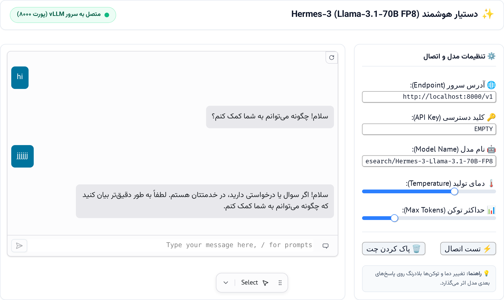

# 🦅 Hermes Black Bird

<p align="center">
  
</p>

<p align="center">
  
  
  
  
  
  
</p>

---

## 📖 معرفی پروژه (Project Overview)

پروژه **Hermes Black Bird** یک زیرساخت مدرن، بومی‌سازی‌شده و سبک برای اجرای بلادرنگ و تعامل مستقیم با مدل زبانی قدرتمند **NousResearch/Hermes-3-Llama-3.1-70B-FP8** است. این سامانه با تلفیق توان پردازشی استنتاج پرسرعت **vLLM** و انعطاف‌پذیری نوت‌بوک تعاملی **Marimo**، یک محیط کاری حرفه‌ای، زیبا و کاملاً راست‌به‌چپ (RTL) همراه با تایپوگرافی اصیل فارسی (قلم وزیرمتن آفلاین) را در اختیار پژوهشگران، توسعه‌دهندگان و کاربران قرار می‌دهد.

هدف این پروژه، رفع چالش‌های متداول در راه‌اندازی مدل‌های بسیار سنگین (۷۰ میلیارد پارامتری) در محیط‌های تحقیقاتی و کلود، از جمله مدیریت مصرف حافظه GPU، استریمینگ بلادرنگ، فراخوانی ابزارها (Tool Calling)، و انتقال داده به حافظه‌های ابری است.

---

## ✨ ویژگی‌های کلیدی (Key Features)

- **🎨 رابط کاربری راست‌به‌چپ (RTL) مدرن:** طراحی اختصاصی مبتنی بر اصول مینیمال تم روشن (Light Theme) و سازگاری کامل با جهت‌گیری فارسی.
- **🔤 فونت وزیرمتن آفلاین (Embedded Base64):** بی‌نیازی مطلق از اینترنت یا سرویس‌های CDN خارجی؛ فونت‌ها به صورت وکتوری Base64 در فایل استایل تزریق شده‌اند تا با خط‌مشی‌های امنیتی مرورگر (CSP) نیز بدون خطا بارگذاری شوند.
- **⚡ استریمینگ بلادرنگ توکن‌ها:** دریافت پاسخ‌های مدل به صورت استریم و تدریجی از طریق توابع مولد (Generators) مریمو و کتابخانه استاندارد `openai`.
- **🟢 نشانگر وضعیت اتصال هوشمند:** بررسی خودکار و منظم ارتباط با سرور محلی vLLM روی پورت ۸۰۰۰ همراه با نمایش پالس نوری وضعیت زنده.
- **🎛️ پنل تنظیمات پیشرفته (Sidebar Settings):** قابلیت سفارشی‌سازی بلادرنگ پارامترهای استنتاج از قبیل دما (`temperature`)، سقف توکن‌ها (`max_tokens`)، کلید API و آدرس سرویس‌دهنده.
- **🛠️ پشتیبانی کامل از Tool Calling:** هماهنگی دقیق با پارسر ابزار اختصاصی Hermes جهت اجرای تسک‌های ترکیبی، ساختاریافته و چندمرحله‌ای JSON.
- **☁️ همگام‌سازی ابری وزن‌ها (Google Drive Sync):** اسکریپت اختصاصی جهت پشتیبان‌گیری و بازیابی پایدار کش ۵۰ گیگابایتی وزن‌ها به/از Google Drive بدون بارگیری مجدد از وب.

---

## 📁 ساختار پوشه‌ها و فایل‌ها (Project Structure)

```text
Hermes-Black-bird/
│
├── .gitignore                  # جلوگیری از آپلود مدل‌ها، کش‌ها و فایل‌های حساس
├── README.md                   # مستندات کامل، راهنما و نقشه راه پروژه
├── requirements.txt            # لیست پکیج‌ها و وابستگی‌های پایتونی
├── notebook.py                 # نوت‌بوک اصلی Marimo (رابط کاربری تعاملی چت)
├── custom.css                  # استایل‌های تم روشن و کدهای فونت تعبیه‌شده وزیرمتن
├── CONVERSATION_HISTORY.md     # آرشیو کامل مراحل توسعه، چالش‌ها و تصمیمات فنی
│
├── assets/                     # منابع گرافیکی و تایپوگرافی
│   ├── preview.png             # تصویر پیش‌نمایش محیط تعاملی برنامه
│   ├── Vazirmatn-Regular.woff2 # فونت وب خام وزیرمتن (عادی)
│   └── Vazirmatn-Bold.woff2    # فونت وب خام وزیرمتن (ضخیم)
│
└── scripts/                    # اسکریپت‌های اجرایی و کمکی
    ├── start_vllm.sh           # اسکریپت اجرای پس‌زمینه سرور vLLM با تنظیمات بهینه
    ├── start_marimo.sh         # اسکریپت آماده‌سازی و راه‌اندازی سرور نوت‌بوک Marimo
    ├── gdrive_sync.py          # اسکریپت همگام‌سازی هوشمند وزن‌های مدل با Google Drive
    └── test_hermes_tools.py    # اسکریپت راستی‌آزمایی فراخوانی توابع (Function Calling)
```

---

## 🚀 راهنمای نصب و اجرا (Quickstart)

### ۱. پیش‌نیازها و نصب پکیج‌ها
ابتدا مطمئن شوید پایتون ۳.۱۰ یا بالاتر نصب است، سپس پیش‌نیازها را نصب کنید:
```bash
pip install -r requirements.txt
```

### ۲. راه‌اندازی سرور استنتاج vLLM
اسکریپت آماده‌شده سرور vLLM را با پارامترهای اختصاصی FP8 و طول کانتکست ۳۲K راه‌اندازی می‌کند:
```bash
bash scripts/start_vllm.sh
```

### ۳. اجرای برنامه تعاملی Marimo
برای اجرای رابط کاربری در حالت اپلیکیشن چت (App Mode):
```bash
marimo run notebook.py --port 2718
```
یا در صورت نیاز به توسعه و ویرایش سلول‌های نوت‌بوک:
```bash
marimo edit notebook.py --port 2718
```

---

## ⚙️ پیکربندی پیش‌فرض سرور (Server Configuration)

| پارامتر | مقدار | توضیح فنی |
| :--- | :--- | :--- |
| **Model** | `NousResearch/Hermes-3-Llama-3.1-70B-FP8` | مدل وزنی کوانتیزه FP8 با کیفیت نزدیک به مدل کامل |
| **Serving Port** | `8000` | پورت سازگار با استاندارد OpenAI Chat Completions |
| **Max Context** | `32768` | حداکثر پنجره کانتکست مکالمه و پرامپت |
| **GPU Utilization** | `0.90` | درصد بهینه‌شده تخصیص حافظه کارت گرافیک |
| **Tool Calling** | `--tool-call-parser hermes` | مفسر ویژه تگ‌های ابزار مدل هرمس |

---

## 🗺️ نقشه راه توسعه (Roadmap)

- [x] **فاز ۱: پایه‌ریزی زیرساخت استنتاج**
  - [x] کانفیگ و بنچمارک سرور vLLM با مدل FP8 روی GPU با حافظه محدود
  - [x] پیاده‌سازی مکانیزم همگام‌سازی وزن‌های ۵۰ گیگابایتی با Google Drive
  - [x] تست موفق ابزارهای فراخوانی تابع (Tool Calling)
- [x] **فاز ۲: طراحی رابط کاربری تعاملی فارسی**
  - [x] طراحی برنامه چت در نوت‌بوک مریمو با پشتیبانی از استریمینگ
  - [x] رفع وابستگی خارجی فونت وزیرمتن با ادغام Base64 آفلاین
  - [x] اصلاح تم روشن (Light Mode) و ایجاد بالاترین کنتراست متن و کارت‌ها
- [ ] **فاز ۳: بهبود قابلیت‌های چت و ابزارها (در دست اقدام)**
  - [ ] افزودن تاریخچه چندگفتگویی (Session History) با قابلیت ذخیره در دیتابیس SQLite
  - [ ] ادغام مستقیم ابزارهای جستجوی وب (Web Search) و اجرای کد پایتون در UI نوت‌بوک
  - [ ] پشتیبانی از بارگذاری اسناد متنی و PDF جهت پرسش و پاسخ (RAG ساده)
- [ ] **فاز ۴: بسته‌بندی کانتینری و استقرار یکپارچه**
  - [ ] ارائه Dockerfile بهینه‌سازی‌شده بر پایه CUDA
  - [ ] پشتیبانی از ارکستراسیون با Docker Compose برای اجرای خودکار vLLM و Marimo به عنوان یک سرویس

---

## 📜 لایسنس و حقوق نشر

این پروژه تحت مجوز **MIT** منتشر شده است و استفاده از آن برای اهداف آموزشی، پژوهشی و تجاری با رعایت شرایط مجوز آزاد می‌باشد.
توسعه‌یافته توسط تیم **Hermes Black Bird**.
